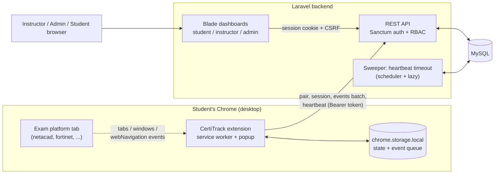
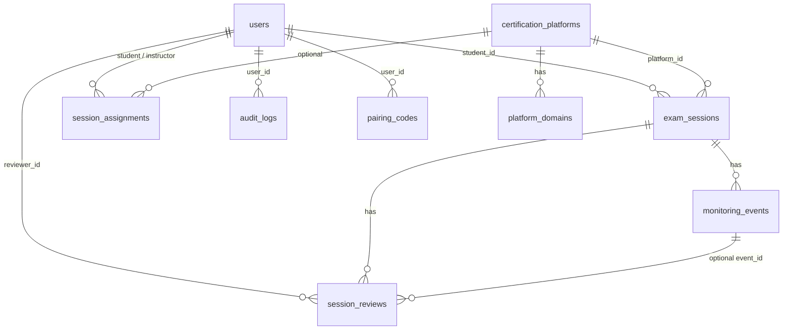

# CertiTrack — Privacy-Preserving Browser-Based Online Certification Examination Monitoring System

CertiTrack records a small, predefined set of **browser activity signals** (tab switches, new tabs, exam-tab closure, navigation outside approved domains, window focus loss, connection loss) during **explicitly started** monitoring sessions on external certification platforms (e.g. Cisco Networking Academy, Fortinet Training Institute). A Chrome extension reports them to a Laravel backend; instructors review timelines in a web dashboard.

> **CertiTrack records technical activity. It does not detect, prevent or prove cheating.** Events can have innocent explanations, a determined user can disable the extension, and browser-generated records are not tamper-proof. Instructors, not software, make judgements.

---

## 0. Verification status

**Initial build (sandbox):** the code was produced in a sandbox with no PHP/MySQL/Composer access and no Chrome. At that point only the extension logic tests (31/31 against a fake Chrome API and an in-memory contract stub) and PHP syntax checks had been executed.

**Maintainer verification (Ubuntu 22.04, real Chrome):** the maintainer subsequently reported that all tests passed and that the extension works in Chrome against the real backend. Specifically reported as passing: the extension logic tests, the Laravel PHPUnit suite, `tests/integration/e2e-smoke.mjs` against Laravel + MySQL, and manual use of the extension. Those runs were not performed or observed by the author of this document and their output is not stored in the repository; re-run them on your own environment (§17) before relying on the system.

| Area | Status |
|---|---|
| Extension logic tests | ✅ 31/31 (`documentation/test-results-extension.json` records the stub-based run) |
| PHPUnit backend tests | ✅ Reported passing |
| End-to-end gate against Laravel + MySQL | ✅ Reported passing |
| Extension in real Chrome | ✅ Reported working |
| Dashboards rendered with real data | ✅ Reported working as part of manual use (no automated UI tests exist) |
| 95% capture target | ⬜ Not formally measured |
| `composer.lock` | ⬜ Not included; commit the one `composer install` generates |
| Other OS / PHP versions / MySQL variants | ⬜ Not verified |

## 1. Purpose and scope
Monitors browser activity during explicitly activated examination sessions. **Out of scope:** certificate tracking/verification, exam hosting, grading.

## 2. Features and roles
**Student** — register/login; pair the extension with a one-time code; see supported platforms; start/end monitoring (in the extension); see active status, last heartbeat/connection state; session history and own event timelines; a page explaining exactly what is collected; revoke paired extensions; end a stuck session from the dashboard.
**Instructor** — sees only assigned students (optionally per platform); active/interrupted/completed sessions; timelines; filters (student, platform, date range, status, review status, free text), sorting, pagination; flag events; record review outcome + remarks; printable report and CSV export.
**Administrator** — user CRUD/deactivation; platform registry + approved domain rules; student↔instructor assignments; monitoring rules (heartbeat interval/timeout, enabled event types, retention, require-assignment); system statistics; audit log; manual retention purge.
RBAC is enforced server-side (middleware + query scoping `ExamSession::visibleTo`). Records you may not see return **404**, not 403.

## 3. Architecture
| Component | Responsibility |
|---|---|
| `certitrack-extension/` (Chrome MV3) | Pairing, consent, session start/end, event detection, durable queue, heartbeats, resync. |
| `backend/` (Laravel + Sanctum) | Auth, RBAC, platform registry, session/event ingestion, timeouts, reviews, audit, REST API, Blade dashboards. |
| MySQL | Users, platforms, domains, sessions, events, reviews, assignments, audit logs, settings. |
| Dashboards (Blade + Bootstrap 5 + Chart.js, vendored locally) | Call the `/api/*` endpoints with the web session cookie (Sanctum stateful mode). No hard-coded data. |



**Key design points**
* **Server time is authoritative** (`received_at`). Client timestamps only order events (`occurred_at` = client time clamped to `[session start, now]`).
* **Dedupe:** client UUID per event (globally unique) + per-session sequence number (`unique(session_id, seq)`); batches (≤100) return per-event results (`accepted / duplicates / rejected`) so one bad event never blocks the queue.
* **Severity is assigned by the server** from `config/certitrack.php`; clients cannot choose it. Detail values are whitelisted (host name only; never URLs, queries, titles).
* **Integrity hint:** the extension reports its highest sequence number on heartbeat/end; the dashboard shows *"extension reports N events that never reached the server"* when counts differ.
* **Late sync:** events arriving after the session ended are kept and marked `late sync` (never silently dropped).
* **Suspension-safe extension:** all state and the queue live in `chrome.storage.local`, written atomically under a lock; listeners are registered at worker start; alarms (30 s period, best-effort) drive heartbeat/sync; the server timeout (default 120 s) is much longer than the alarm period.
* **No content script.** Everything needed comes from `tabs`/`windows`/`webNavigation`, so the extension never touches page content (privacy, and fewer permissions). The suggested `scripts/content.js` was intentionally omitted.
* **Review priority score** (weighted event count, info 0 / low 1 / medium 3 / high 5) exists only to sort sessions for manual review; it is labelled as such and is not a cheating probability.

## 4. Technology stack
| Part | Version |
|---|---|
| Chrome | 120+ desktop (Manifest V3; 30 s alarms) |
| PHP | 8.2+ (developed against 8.3 syntax check) |
| Laravel | 12 (`^12.0`; code uses only Laravel 11/12-compatible APIs) |
| Laravel Sanctum | ^4.0 |
| MySQL Community | 8.0+ (schema is portable; PHPUnit uses SQLite in memory) |
| Bootstrap | 5.3.3 (vendored in `backend/public/vendor`) |
| Chart.js | 4.4.3 (vendored) |
| Node.js | 18+ only for the test runners (no npm dependencies) |

## 5. Prerequisites
* PHP ≥ 8.2 with extensions `pdo_mysql`, `mbstring`, `openssl`, `tokenizer`, `xml`, `ctype`, `json`, `fileinfo`; (`pdo_sqlite` for PHPUnit).
* Composer 2, MySQL 8 (Community), Google Chrome 120+, Node 18+ (tests only), Git (optional).
* Internet access for `composer` (Packagist/GitHub). Local demonstration needs no paid service. ~1 GB disk, 2 GB RAM is plenty.

## 6. Install
```bash
unzip CertiTrack-Complete-Project.zip && cd CertiTrack
./scripts/setup-backend.sh            # Windows: powershell -ExecutionPolicy Bypass -File scripts\setup-backend.ps1
```
The ZIP contains CertiTrack's own Laravel source. The script downloads the **stock Laravel 12 skeleton only to fill in framework boilerplate** (`artisan`, `public/index.php`, `config/*.php`, …) without overwriting CertiTrack files, runs `composer install`, copies `.env.example` → `backend/.env` and runs `key:generate`. (Alternative if you prefer: `composer create-project laravel/laravel:^12.0 tmp`, copy its files into `backend/` without overwriting, then `composer install`.)

## 7. MySQL database
```bash
mysql -u root -p < database/create-database.sql     # edit the password inside first
```
Creates database `certitrack` (utf8mb4) and user `certitrack`@`localhost`.

## 8. Environment variables (`backend/.env`)
| Variable | Meaning |
|---|---|
| `APP_URL` | e.g. `http://127.0.0.1:8000` |
| `DB_*` | MySQL connection (`DB_PASSWORD` must match step 7) |
| `SESSION_DRIVER=file`, `CACHE_STORE=file` | Defaults; no extra tables needed |
| `SANCTUM_STATEFUL_DOMAINS` | **host:port exactly as typed in the browser** (default `127.0.0.1:8000,localhost:8000`). Dashboards fail with 401/419 if this does not match. |
| `APP_TIMEZONE=UTC` | Keep UTC: all times are stored in UTC and converted to the viewer's timezone in the browser. |
Admin-editable runtime rules (heartbeat interval/timeout, retention, enabled events, …) live in the `system_settings` table, not `.env`.

## 9. Migrate and seed
```bash
cd backend
php artisan migrate --seed
```
Seeds **development accounts only** (no sessions/events are seeded — everything in dashboards comes from real activity):

| Role | Email | Password |
|---|---|---|
| Administrator | `admin@certitrack.test` | `Password123!` |
| Instructor 1 (supervises students 1 & 2) | `instructor1@certitrack.test` | `Password123!` |
| Instructor 2 (supervises student 3) | `instructor2@certitrack.test` | `Password123!` |
| Students | `student1@…`, `student2@…`, `student3@certitrack.test` | `Password123!` |

> **Change or delete these accounts before any real deployment.** Also seeded: platforms *Cisco Networking Academy*, *Fortinet Training Institute* (example hostnames — **verify the real hosts, including SSO hosts, for your exams** and edit them in Admin → Platforms) and *Local Test Page (demo)* (`/demo-target` on this backend).

## 10. Run the backend
```bash
php artisan serve --host=127.0.0.1 --port=8000
php artisan schedule:work          # second terminal: heartbeat-timeout sweep every minute + daily retention purge
```
Even without the scheduler, instructor/admin session lists run a throttled sweep (≤ once per 20 s) so interruptions still appear. In production use the cron entry `* * * * * php /path/backend/artisan schedule:run`, put the app behind **HTTPS**, set `APP_ENV=production`, `APP_DEBUG=false`.

## 11. Install the Chrome extension
1. Chrome → `chrome://extensions` → enable **Developer mode** → **Load unpacked** → select the `certitrack-extension/` folder.
2. Pin the extension (puzzle icon). A red **ON** badge shows whenever monitoring is active.

## 12. Connect the extension to the backend
1. In the popup set the server address (default `http://127.0.0.1:8000`) → **Save server** (Chrome asks for permission to contact that origin; `127.0.0.1:8000`/`localhost:8000` are pre-granted in the manifest, other origins use *optional* host permissions requested on demand).
2. Log in to the web dashboard as a student → **Generate pairing code** → type it in the popup → **Pair**. (The popup also offers email/password sign-in.)
3. Revoke any paired extension from the student dashboard at any time.
For production, replace the two localhost entries in `manifest.json → host_permissions` with your HTTPS origin.

## 13. Demonstration (end-to-end by hand)
1. Student logs in, pairs the extension.
2. Open `http://localhost:8000/demo-target` in Chrome, open the popup, choose **Local Test Page (demo)**, tick the consent box, **Start monitoring**.
3. Switch to another tab and back, open a new tab, click the "example.com" link, switch windows.
4. Student dashboard → *My monitoring* shows the active session and events; **End monitoring** in the popup.
5. Log in as `instructor1@certitrack.test` → open the session → timeline, flag an event, save a review, *Generate report*.
6. To test offline queueing: stop `php artisan serve`, perform activities, restart it; events appear after the next 30 s alarm (popup → *Retry now* is not needed but available while ending).

## 14. User guides
**Student:** pair once; before an exam open the platform page in Chrome, start monitoring from *that* tab, press End when done. The popup shows platform, duration, connection, events recorded vs waiting to sync, and whether the exam tab is tracked. If the exam tab is closed, reopening an approved page re-binds it (recorded).
**Instructor:** *Sessions* → filter/sort → *Open*. Timeline shows server-assigned severity, `late sync` and `server` badges. *Flag* an event, choose an outcome (Reviewed / No concern / Requires further investigation / Pending review), add remarks. *Generate report* for print/PDF + CSV. Every view of events/reports is audit-logged.
**Administrator:** Users, Platforms (add a platform + its domains → the extension picks it up via `/api/platforms/config`; **no extension code change**), Assignments, Settings, Audit log. Include SSO/login hosts in a platform's domains, or normal sign-in redirects will be recorded as "navigation outside approved domains".

## 15. API (JSON; Bearer token or web session)
Errors: `{"message": "...", "errors": {...}}` with 401 unauthenticated, 403 wrong role, 404 not found **or not yours**, 409 conflict/closed, 422 validation, 429 throttled. Success: `{"data": ...}` (lists are Laravel paginators).

| Method & path | Role | Purpose |
|---|---|---|
| `POST /api/login` | public | email+password → token |
| `POST /api/extension/pair` | public | one-time code → extension token |
| `POST /api/pairing-codes` | student | create 10-min code |
| `GET /api/extension/devices`, `DELETE /api/extension/devices/{id}` | student | list/revoke paired extensions |
| `GET /api/me`, `POST /api/logout` | any | |
| `GET /api/platforms`, `GET /api/platforms/config` | any | registry / extension config |
| `GET /api/stats` | any | role-scoped aggregates |
| `POST /api/sessions` | student | start (consent required) |
| `GET /api/sessions`, `GET /api/sessions/active` | student | history / open session |
| `GET /api/sessions/{id}`, `GET /api/sessions/{id}/events` | scoped | student own / instructor assigned / admin all |
| `POST /api/sessions/{id}/events` | owner student | batch ingest (≤100) |
| `POST /api/sessions/{id}/heartbeat`, `POST /api/sessions/{id}/end` | owner student | |
| `GET /api/instructor/students`, `GET /api/instructor/sessions` | instructor, admin | filters: `student_id, platform_id, status, review_status, from, to, q, sort, dir, page` |
| `GET /api/instructor/sessions/{id}/events`, `.../report` | instructor, admin | audited |
| `POST /api/instructor/sessions/{id}/review`, `DELETE .../events/{eventId}/flag` | instructor | |
| `/api/admin/users`, `/platforms`, `/platforms/{id}/domains`, `/domains/{id}`, `/assignments`, `/settings`, `/audit-logs`, `/retention/purge` | admin | CRUD / configuration |

**Examples**
```http
POST /api/login
{"email":"student1@certitrack.test","password":"Password123!"}
→ 200 {"data":{"token":"1|abc…","user":{"id":4,"name":"Sara Student","email":"…","role":"student"}}}
```
```http
POST /api/sessions                       Authorization: Bearer <token>
{"platform_id":3,"consent":true,"client_id":"2f1c…"}
→ 201 {"data":{"id":12,"status":"active","platform":{"id":3,"name":"Local Test Page (demo)"},"started_at":"2026-11-15T09:00:00.000000Z", …}}
→ 409 {"message":"A monitoring session is already open.","data":{…}}      # one open session per student
```
```http
POST /api/sessions/12/events
{"events":[{"event_uuid":"7b0c…","seq":1,"type":"tab_switched","client_timestamp":"2026-11-15T09:01:10.120Z","details":{"direction":"away"}}]}
→ 200 {"data":{"accepted":["7b0c…"],"duplicates":[],"rejected":[],"session_status":"active","server_time":"…"}}
# re-sending the same batch → "accepted":[],"duplicates":["7b0c…"]
```
```http
POST /api/sessions/12/heartbeat   {"last_seq":1}   → 200 {"data":{"status":"active","server_time":"…","heartbeat_interval_sec":30}}
                                                   → 409 once the session is completed/abandoned
POST /api/sessions/12/end         {"last_seq":1}   → 200 {"data":{"status":"completed", …}}   # idempotent
POST /api/instructor/sessions/12/review {"status":"requires_investigation","remarks":"…","event_id":57}
→ 201 {"data":{"id":3,"status":"requires_investigation","reviewer":{"id":2,"name":"Ines Instructor"}}}
```
Event types the extension may send: `tab_switched, tab_opened, window_focus_lost, window_focus_gained, navigation_outside_domain, navigation_returned, exam_tab_closed, exam_tab_reopened, connection_lost, connection_restored`. Server-generated: `session_started, session_ended, heartbeat_timeout, extension_disconnected, monitoring_resumed, session_abandoned`.

| Event | Severity | | Session status | Review status |
|---|---|---|---|---|
| tab switched / new tab / focus lost | low | | scheduled | pending_review |
| navigation outside domains / exam tab closed / heartbeat timeout / connection lost | medium | | active | reviewed |
| extension disconnected | high | | interrupted | no_concern |
| focus gained / returned / reopened / restored / resumed / started / ended | info | | completed, abandoned | requires_investigation |

Heartbeat rules (defaults, admin-editable): silent > 120 s → **interrupted** + `heartbeat_timeout`; silent ≥ 240 s → `extension_disconnected` (once); silent ≥ 1800 s → **abandoned**; any heartbeat/event batch after an interruption → **active** + `monitoring_resumed`.

## 16. Database schema

| Table | Notes |
|---|---|
| `users` | `role` enum student/instructor/admin, `is_active` |
| `certification_platforms`, `platform_domains` | domain rule = `host` + `match_type` (`suffix` = host and subdomains, `exact`) + optional `path_prefix`; unique (platform, host, path) |
| `session_assignments` | student ↔ instructor, optional platform (NULL = all) |
| `exam_sessions` | `status`, `review_status`, consent version/time, start/end/last heartbeat, `event_count`, `review_score`, `client_last_seq`; indexes on student/status, platform/status, started_at, review_status |
| `monitoring_events` | `event_uuid` unique, unique (`session_id`,`seq`), `severity`, `source`, `client_timestamp`, `received_at`, `occurred_at`, whitelisted JSON `details`, `received_after_end`, `flagged` |
| `session_reviews` | reviewer, status, remarks, optional event |
| `audit_logs` | action, subject, metadata, IP (logins excluded; reviews, event/report views, admin changes included) |
| `pairing_codes` | SHA-256 of one-time code, expiry, used_at |
| `system_settings` | key → JSON (admin rules) |
| `personal_access_tokens`, `sessions`, `password_reset_tokens` | Sanctum / Laravel |
All timestamps are UTC.

## 17. Testing
### 17.1 Extension tests (executed in the sandbox)
```bash
npm run test:extension        # or: node tests/extension/run-tests.mjs   (Node 18+)
```
Real extension modules run in separate Node processes (one per simulated service-worker lifetime; state only survives via the storage file) against a **fake Chrome API** (`fake-chrome.js`, events injected by the test) and an **in-memory contract stub** (`stub-server.js`, *not Laravel*). **Result when run in the sandbox: 31/31 passed** (details: `documentation/test-results-extension.json`). Covered: pairing; consent refusal; platform detection (wrong tab refused); new platform via config only; each event type; sequence numbers; host-only privacy; subframe ignoring; offline queueing across restarts; resync after reconnect; no duplicates after a lost response; heartbeat/interruption/resume contract; server-closed session; end while offline; browser-restart handling.
**Scope note:** this suite alone does not exercise real Chrome or Laravel/MySQL; those are covered by §17.2 and manual use.

### 17.2 Integration gate against the real backend
```bash
# backend running with migrated+seeded DB
BASE_URL=http://127.0.0.1:8000 node tests/integration/e2e-smoke.mjs
```
Automates: logins → pairing → start session (consent, 409 on second) → batch events → duplicate resend → server-only types rejected → heartbeat → other-student 404 → assigned instructor reads events → unassigned instructor 404 → review → end (idempotent) → heartbeat 409 → events still readable → late event accepted. Then do the manual demonstration in §13 with real Chrome and the checklist: events not duplicated; events survive stopping the server; service-worker suspension (`chrome://serviceworker-internals` → Stop, then keep browsing); interruption + resume. Postman collection: `tests/integration/postman-collection.json`.

### 17.3 Backend PHPUnit
```bash
cd backend && php artisan test        # SQLite in memory; needs pdo_sqlite
```
`tests/Feature`: auth, RBAC and 404 scoping, pairing, consent/one-open-session, batch storage + server severity + URL stripping, duplicates/invalid/seq conflict, late events, heartbeat timeout→interrupted→disconnected→resumed→abandoned, review + audit + scoping, new platform via admin API appearing in `/platforms/config`, admin self-demotion guard, settings validation.

### 17.4 Acceptance checklist status
Status as reported by the maintainer after running the suites and using the extension in Chrome on Ubuntu 22.04. Items marked automated are covered by a test in this repo; the rest were verified manually.

| # | Item | Coverage |
|---|---|---|
| 1–2 | Authentication, RBAC | Automated (PHPUnit, smoke) — reported passing |
| 3 | Extension pairing | Automated (extension tests, smoke) + manual — reported passing |
| 4 | Platform detection | Automated (extension tests) + manual |
| 5 | Session start/end | Automated + manual |
| 6–10 | Tab switch, new tab, unapproved navigation, focus loss, exam tab closure | Automated with injected events; manual in real Chrome — reported working |
| 11 | Event submission & DB storage | Automated (PHPUnit, smoke) — reported passing |
| 12 | Duplicate rejection | Automated (extension tests, PHPUnit, smoke) |
| 13–14 | Offline queue, resync | Automated (fake Chrome + stub); manual check recommended (§13 step 6) |
| 15 | Heartbeat timeout/interruption | Automated (PHPUnit) |
| 16 | Dashboard shows real events | Manual only (no automated UI tests) |
| 17–19 | Student/instructor restrictions, review | Automated (PHPUnit, smoke) |
| 20 | New platform via configuration | Automated (extension tests, PHPUnit) |
| — | ≥95% capture target | **Not formally measured.** Define a controlled scenario set, run it in real Chrome, and record captured/expected |

## 18. Troubleshooting
| Symptom | Fix |
|---|---|
| Dashboard shows red "Unauthenticated"/419 | `SANCTUM_STATEFUL_DOMAINS` must equal the address-bar host:port; `php artisan config:clear` |
| Extension: "Cannot reach server" | Server running? Address saved? Click *Save server* and accept the permission prompt; `http://` is fine for localhost only |
| "Open the … page in this window first" | Active tab must match the platform's domains (Admin → Platforms); start from that tab |
| Normal sign-in counted as "outside domain" | Add the SSO host to the platform's domains |
| No `heartbeat_timeout` events | Run `php artisan schedule:work` or just open the instructor session list (lazy sweep) |
| `could not find driver` | enable `pdo_mysql` (or `pdo_sqlite` for tests) in php.ini |
| `Class "…" not found` after copying files | `composer dump-autoload` |
| Extension says signed out | Pair again; unsent events are retained and sent after re-pairing as the same student |
| Alarms feel slow | Chrome enforces ≥30 s alarm periods and may delay them; timeouts are sized accordingly |

## 19. Known limitations and unsupported scenarios
* Only **Chrome desktop on one machine**; other browsers, apps and devices are invisible. Users can disable/uninstall the extension (the server then records missed heartbeats). Client records can be forged by someone who can call the API with a paired token. **Not tamper-proof; does not prevent or prove cheating.**
* A platform's exam may run in another window/app (e.g. a proctoring client), a different browser profile, or in an iframe-heavy flow — such cases are not supported. Hostname lists in the seed data are examples and unverified.
* Window-focus events can produce false positives (OS dialogs, notifications, DevTools, some multi-window setups) and Chrome emits transient focus events; the extension debounces by 300 ms but this is untested on real hardware.
* Heartbeat/queue timing depends on `chrome.alarms` (≥30 s, best-effort) and on the worker being woken; very long worker suspension while offline is handled by persistence but only simulated in tests.
* Queue capped at 5,000 events; overflow drops oldest and is counted and shown (never silent).
* No content script: page visibility/blur inside the page and multi-monitor focus are not observed beyond Chrome window focus.
* Admin cannot edit severity mappings in the UI (they are in `config/certitrack.php`); email notifications, password reset and SSO login are not implemented; dashboard auto-refresh is polling (15 s).
* Retention: closed sessions are deleted after `retention_days`; no per-student deletion request workflow beyond admin purge/deactivation.
* Not legal advice: consider RA 10173 (Data Privacy Act of 2012), obtain institutional approval, publish a privacy notice, appoint/consult your DPO, and run a privacy impact assessment before use.
* Verified only on the maintainer's Ubuntu 22.04 setup; `composer.lock` and Laravel's own `config/` come from the bootstrap script.

## 20. Future enhancements
Real-browser E2E tests (Playwright/puppeteer with the extension), signed event batches with server-held per-session keys to make forgery harder, configurable severity rules in the UI, optional page-visibility content script behind an explicit opt-in, per-student data export/deletion requests, email/webhook alerts for interrupted sessions, Firefox/Edge ports, SSO, i18n, Laravel Pint/Pest CI.

## Project layout
```
CertiTrack/
├── backend/                 Laravel source overlay (app, routes, database, resources, public, tests, config/certitrack.php)
├── certitrack-extension/    Chrome MV3 extension (background/, popup/, services/, assets/)
├── database/                create-database.sql
├── documentation/           test-results-extension.json
├── scripts/                 setup-backend.sh / .ps1
├── tests/                   extension/ (fake Chrome + stub), integration/ (smoke script, Postman)
├── .env.example  LICENSE  README.md  package.json
```
Licence: MIT (`LICENSE`). Bootstrap and Chart.js are MIT-licensed; their licences are in `backend/public/vendor/`.
